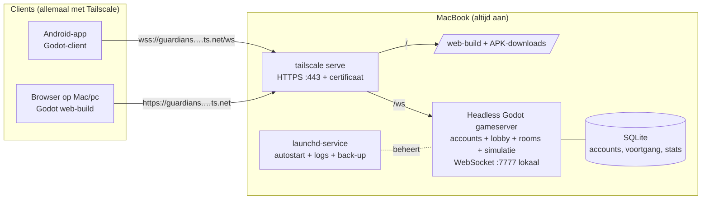
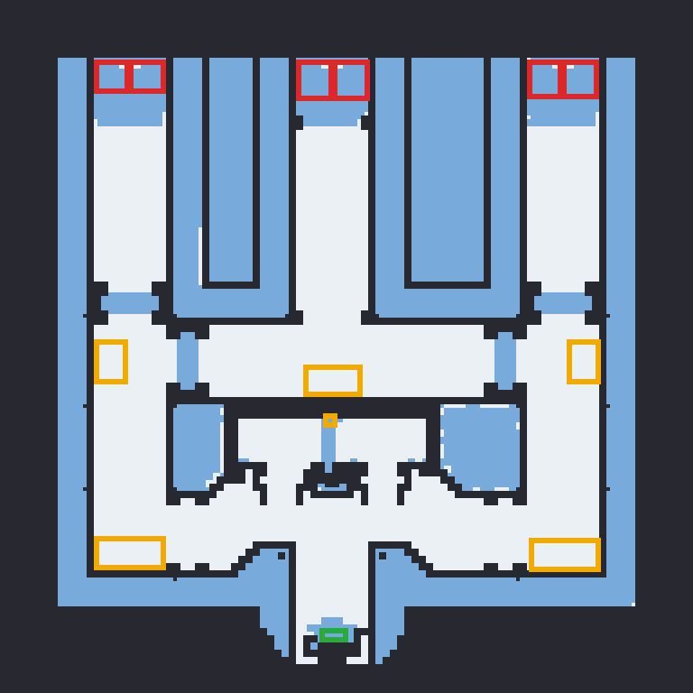

# Guardians: analyse en stappenplan

> **Guardians**: een moderne tower defense in de geest van *Wintermaul* en andere Warcraft III-TD's,
> voor **Android en de browser** (Mac/pc). Multiplayer via een eigen server op de MacBook, bereikbaar via **Tailscale**.
>
> Versie 0.4, 22 oktober 2026. Dit is een levend document: keuzes die nog open staan, zijn gemarkeerd met **❓** en verzameld in §11.
>
> **Beslist (22-10-2026):** naam **Guardians** · **Android (APK via link) + browserversie** · **1–4 spelers co-op** · modi **Klassiek + Modern** ·
> stijl **3D low-poly isometrisch** · **accounts met voortgang** · **niet commercieel** · Mac **altijd aan** op netstroom ·
> varianten: eerst **Wintermaul Wars**, daarna andere WC3-TD's zoals **NOOB Killer TD** · engine **Godot 4 + GDScript** ·
> taal **NL + EN** · thema **winter/ijs** (eigen thema per latere variant).

Bijhorende documenten:

- [`docs/research/wintermaul-v13-data.md`](research/wintermaul-v13-data.md): alle waves, torens, elementen en regels die rechtstreeks uit de originele map zijn gehaald
- [`docs/research/wintermaul-layout.png`](research/wintermaul-layout.png): de originele kaart, gerenderd uit de pathing-data
- [`docs/research/noob-killer-td.md`](research/noob-killer-td.md): analyse van NOOB Killer TD en andere WC3-TD's voor latere varianten
- [`tools/w3x-extract/`](../tools/w3x-extract/): scripts om dezelfde data uit andere (Wintermaul-)maps te halen

---

## Inhoud

1. [Samenvatting en aanbevolen keuzes](#1-samenvatting-en-aanbevolen-keuzes)
2. [Analyse van het origineel](#2-analyse-van-het-origineel)
3. [Juridisch: wat mag wel en niet](#3-juridisch-wat-mag-wel-en-niet)
4. [Technische architectuur](#4-technische-architectuur)
5. [Netwerk: Tailscale en de MacBook-server](#5-netwerk-tailscale-en-de-macbook-server)
6. [Assets: graphics, audio en fonts](#6-assets-graphics-audio-en-fonts)
7. [Mobiele UX: Wintermaul op een touchscreen](#7-mobiele-ux-wintermaul-op-een-touchscreen)
8. [Gamedesign: trouw aan het origineel, modern waar het helpt](#8-gamedesign-trouw-aan-het-origineel-modern-waar-het-helpt)
9. [Stappenplan in fasen](#9-stappenplan-in-fasen)
10. [Software en accounts die op de Mac nodig zijn](#10-software-en-accounts-die-op-de-mac-nodig-zijn)
11. [Open vragen en keuzes voor jou ❓](#11-open-vragen-en-keuzes-voor-jou-)
12. [Risico's](#12-risicos)
13. [Bronnen](#13-bronnen)

---

## 1. Samenvatting en aanbevolen keuzes

| Onderwerp | Aanbeveling | Waarom |
|---|---|---|
| Engine | **Godot 4.x** (GDScript) | Gratis en open source (MIT). Exporteert naar iOS, Android, macOS en web. Dezelfde code draait als *headless* server op de Mac, dus de spellogica bestaat maar één keer |
| Netwerkmodel | **Server-authoritative**: de Mac simuleert, telefoons sturen alleen commando's | Geen valsspelen of desyncs. Telefoons die even wegvallen kunnen opnieuw verbinden |
| Transport | **WebSocket over TLS (`wss://`)** voor alle clients | Browsers kunnen geen UDP. Eén transport voor Android en web houdt het simpel. TLS-certificaat en proxy komen gratis van `tailscale serve`. Voor een tower defense is TCP-latency ruim voldoende |
| Netwerk | **Tailscale**: server op de MacBook, spelers in je tailnet of via *node sharing* | Geen port forwarding, end-to-end versleuteld en gratis voor persoonlijk gebruik |
| Stijl | **3D low-poly, isometrische camera** ✅ beslist | Gratis CC0-assets van Kenney, Quaternius en KayKit passen perfect en draaien licht op gsm's |
| Inhoud v1 | Modi **Klassiek** (exact v13) + **Modern** (upgrade-bomen, QoL) ✅ beslist. Wintermaul v13-ruleset: 9 elementen, ±46 torens + ultieme toren, 30 waves + 5 bonus, 4 moeilijkheden | Volledig gedocumenteerd vanuit de originele map |
| Platform | **Android + browser** ✅ beslist | APK via een downloadlink en een web-build (Godot web-export) die de Mac zelf host, voor Mac en pc. iOS kan later met dezelfde code |
| Accounts | **Accounts met voortgang** ✅ beslist | Login op Android en web, profiel, XP/levels, records, achievements, matchgeschiedenis en hervatbare matches (§4.7) |
| Server | **MacBook altijd aan** ✅ beslist | launchd-service, slaapstand uit op netstroom, nachtelijke databaseback-up (§5.4) |
| Spelers | **1–4 co-op** ✅ beslist (origineel 9) | Leesbaar op een klein scherm, eigen lane per speler |
| Later | Varianten als *data packs*: **Wintermaul Wars** (PvP/sends), daarna **NOOB Killer TD** en andere WC3-TD's | De architectuur is data-gedreven vanaf dag 1 |



---

## 2. Analyse van het origineel

### 2.1 Wat is Wintermaul?

*Wintermaul TD* (Duke-Wintermaul, 2002–2003, Warcraft III: Reign of Chaos) is een coöperatieve
tower defense voor 9 spelers op een sneeuwkaart (Northrend). Creeps lopen van boven (3 ingangen, 6
spawnpunten) naar een **schip** onderaan. Het genre-bepalende element is **mazing**: er zijn geen
vaste paden, je bouwt zelf een doolhof van torens om het pad zo lang mogelijk te maken. Uit
Wintermaul ontstonden **Wintermaul Wars** (PvP met creeps sturen en income), **Wintermaul One** (49 races) en
indirect een heel genre (Element TD, Legion TD, ...).

De volledige geëxtraheerde data staat in [`research/wintermaul-v13-data.md`](research/wintermaul-v13-data.md).
De belangrijkste punten:



- **35 levels**: 30 echte plus 5 bonuslevels zonder levensverlies. Bosses op 10, 20 en 30, luchtwaves op 5, 15, 25 en 29
- **Gedeelde levens**: Easy 40, Normal 20, Hard 10 of Perfection 1. Als de eindbaas van level 30 ontsnapt, is het direct verloren
- **Economie**: 30 startgoud, kleine bounty per kill, oplopende levelbonus (12 + 2·L), 1 hout bij de start en 1 na level 15
- **Elementen**: Fire, Ice, Tech, Electric, Stone, Poison, Nature, Undead en Crystal, elk met 5 torens, plus de ultieme Laser Cannon
- **Ritme**: de volgende wave start pas 30 s nadat de vorige volledig weg is (geen overlap)
- **Specials**: slow, poison, splash, crit, chain lightning, bounce, armor-debuff, %-HP-schade, stun, "zet HP op 10"

### 2.2 Feature-checklist: "alle opties van het origineel"

| # | Feature origineel | In onze v1 | Opmerking |
|---|---|:---:|---|
| 1 | Moeilijkheid kiezen (40/20/10/1 levens) | ✅ | De host kiest in de lobby |
| 2 | Element kiezen met hout, builder per element | ✅ | Als UI-keuzescherm in plaats van een gebouw |
| 3 | 9 elementen × 5 torens + Laser Cannon | ✅ | Eigen namen en art |
| 4 | Vrij bouwen en mazing, anti-block | ✅ | Modern: plaatsing die het pad blokkeert wordt geweigerd, met preview |
| 5 | 3 ingangen, waypoints, schip als doel | ✅ | Kaart herontworpen voor een gsm-scherm |
| 6 | Grond-, lucht- en hover-creeps | ✅ | Lucht negeert de maze en vliegt rechtstreeks via de waypoints |
| 7 | Bosses (10/20/30) + "eindbaas ontsnapt = verlies" | ✅ | |
| 8 | Bonuslevels 31–35 | ✅ | Nieuwe namen en thema |
| 9 | Verkopen van torens | ✅ | Moderne refund-regels (§8) |
| 10 | Levelbonus, bounty, extra hout na level 15 | ✅ | |
| 11 | Leaderboard (kills per speler) | ✅ | Plus MVP-scherm op het einde |
| 12 | Tips tussen levels | ✅ | Als tooltips of codex |
| 13 | 9 spelers | ⚠️ | 1–4 aanbevolen op mobiel ❓ |
| 14 | Chat/commando's (`-help`) | ⚠️ | Vervangen door snelle pings en emotes ❓ |

### 2.3 Moderne toevoegingen (aanbevolen)

- **Pad-preview**: tijdens het plaatsen zie je live het nieuwe creep-pad en de padlengte (+x%)
- **Upgrade-bomen** in plaats van losse torens (zoals Wintermaul One) ❓
- **Drag-to-wall**: met één veeg een muur van goedkope torens bouwen. Dat is essentieel voor mazing op een touchscreen
- **"Volgende wave nu"-knop** met kleine goudbonus. Die versnelt het vroege spel
- **Doelprioriteit per toren**: first, last, strongest of closest
- **Spectate en reconnect**: een telefoon die vergrendelt of van 4G naar wifi wisselt, komt terug in de match
- **Solo- en offline-modus** met dezelfde simulatie lokaal (geen server nodig)

---

## 3. Juridisch: wat mag wel en niet

| Onderdeel | Status | Aanpak |
|---|---|---|
| WC3-modellen, iconen, geluiden en muziek | ❌ © Blizzard | **Niet gebruiken**, ook niet uitpakken voor het spel |
| Naam "Wintermaul" en teksten van de map | ⚠️ | Niet als productnaam gebruiken. Blizzard claimt sinds Reforged (2020) rechten op custom maps. v13 is van 2003, maar we nemen het zekere voor het onzekere |
| Spelmechanieken en getallen | ✅ | Spelregels en balanscijfers zijn als idee niet auteursrechtelijk beschermd. We gebruiken ze als basis en balanceren zelf |
| CC0-assets (Kenney, Quaternius, KayKit, ambientCG, Poly Haven) | ✅ | Vrij, ook commercieel, zonder naamsvermelding (we vermelden ze toch) |
| CC-BY-assets (game-icons.net, sommige Freesound-bestanden) | ✅ met credits | Credits-scherm in het spel bijhouden |
| Tailscale Personal-plan | ✅ privé | Alleen **niet-commercieel**. Bij publieke of commerciële release een ander plan of andere hosting |
| App Store / Play Store | ✅ later | Alleen met 100% eigen of vrij gelicentieerde content |

Bronnen: PC Gamer, GameSpot en TechSpot over de Reforged-EULA (§13). **Geen juridisch advies.** Bij een publieke
release laten we het nakijken.

---

## 4. Technische architectuur

### 4.1 Engine-keuze

| | **Godot 4.x** ✅ | Unity 6 | Web (Three.js/Phaser + PWA) |
|---|---|---|---|
| Kosten/licentie | Gratis, MIT | Gratis tot een omzetgrens, licentievoorwaarden wisselen | Gratis |
| Android (en later iOS) | Ja, APK/AAB-export vanaf de Mac | Ja | Via de browser, geen store nodig |
| Zelfde code als server | **Ja**, headless/dedicated-server export | Ja (Netcode/Mirror), zwaarder | Ja (Node), maar de client is minder performant |
| Gewicht/build-tijd | Licht (~40 MB editor) | Zwaar (GB's) | Licht |
| Geschikt om met Claude te bouwen | **Zeer**: alles is tekst (`.gd`, `.tscn`, `.tres`), CLI-builds en headless tests | Matig: veel binaire en GUI-gebonden setup | Zeer |
| 3D op gsm | Goed (Mobile/Compatibility-renderer) | Zeer goed | Matig tot goed |

**Aanbeveling: Godot 4** (de laatste stabiele versie op het moment van installeren, in 2026 de 4.6/4.7-reeks).
Programmeertaal **GDScript**: de C#-export naar mobiel en web is minder volwassen en GDScript is in Godot het best ondersteund.

**Gevolg van de browserversie:** de Godot web-export draait op WebGL 2 en ondersteunt alleen de **Compatibility-renderer**.
We gebruiken die renderer daarom op alle platformen. Zo ziet het spel er overal hetzelfde uit, en voor low-poly-stijl is
die renderer ruim voldoende. We exporteren *single-threaded* voor het web, dan zijn er geen speciale COOP/COEP-headers nodig.

### 4.2 Netwerkmodel

**Server-authoritative simulatie met vaste tick** (20 Hz):

1. De client stuurt **commando's**: `place_tower(x,y,type)`, `upgrade(id)`, `sell(id)`, `set_target_mode`, `ready`, `ping(x,y)`
2. De server valideert (goud, plaats, anti-block) en past ze toe in de volgende tick
3. De server stuurt **events** (toren geplaatst, creep gespawnd, creep dood, leven verloren, goud) en **snapshots**
   met gekwantiseerde creep-posities en HP aan 10–20 Hz. Clients interpoleren tussen snapshots
4. Projectielen zijn alleen cosmetisch op de client (start en einde via events) en sparen bandbreedte

Bandbreedte: 120 creeps × ~8 bytes × 20 Hz ≈ 19 KB/s per speler. Dat is ruim haalbaar over 4G en Tailscale.

**Transport:** `WebSocketMultiplayerPeer` (Godot) werkt op Android, in de browser en op de server. De server luistert
lokaal op `127.0.0.1:7777`. `tailscale serve` zet daar HTTPS/TLS voor op poort 443 van de Mac. Browsers eisen
`wss://` als de pagina via `https://` geladen wordt, en dat lost `tailscale serve` meteen op.

Waarom geen **lockstep** (zoals WC3 zelf)? Lockstep vraagt bit-exacte determinisme over
Android-toestellen met diverse CPU's en een vastloper bij één trage speler. Dat is te fragiel voor mobiel.

### 4.3 Repository-structuur (voorstel)

```
TD/
├─ docs/                 # dit plan, design, research
├─ game/                 # Godot-project (client + server, één codebase)
│  ├─ project.godot
│  ├─ core/              # simulatie, puur GDScript zonder rendering
│  │  ├─ sim.gd          # tick-loop, deterministische RNG
│  │  ├─ grid.gd         # bouwgrid, bezetting
│  │  ├─ pathing.gd      # flow fields per waypoint, anti-block
│  │  ├─ combat.gd       # targeting, schade, armor-matrix, buffs
│  │  └─ economy.gd
│  ├─ net/               # server.gd, client.gd, protocol.gd (serialisatie)
│  ├─ client/            # scènes, UI, camera, input, VFX, audio
│  ├─ server/            # lobby, rooms, persistence (SQLite)
│  ├─ data/              # JSON: towers, creeps, waves, elements, maps, modes
│  └─ tests/             # GUT/gdUnit4 unit tests + balance-sims
├─ tools/
│  ├─ w3x-extract/       # data uit WC3-maps halen (al aanwezig)
│  └─ balance/           # headless simulaties → CSV/grafiek
├─ server-mac/           # launchd-plist, deploy/back-up-scripts, tailscale serve-config, Tailscale-policy
├─ web/                  # landingspagina: speel in de browser + APK-download + Tailscale-uitleg
└─ .github/workflows/    # CI: headless tests + export-builds
```

### 4.4 Simulatie: kernbeslissingen

- **Grid**: bouwcellen van een halve WC3-tile. Een toren is 2×2 cellen, zoals in WC3, zodat creeps tussen torens door kunnen als er 1 cel vrij is
- **Pathfinding**: een **flow field** (BFS/Dijkstra) per waypoint. Dat wordt alleen herberekend als er een toren bijkomt of weggaat. 120 creeps kosten dan bijna niets
- **Anti-block**: vóór het plaatsen controleert BFS of elk waypoint nog bereikbaar is. Zo niet, dan wordt de plaatsing geweigerd (rode ghost in de UI)
- **Lucht/hover**: lucht vliegt rechtlijnig van waypoint naar waypoint, hover volgt het grondpad
- **Combat**: data-gedreven attack-profielen (`damage[min,max]`, `cooldown`, `range`, `splash`, `projectileSpeed`, `targets`) + **effecten** (`slow`, `poison`, `crit`, `chain`, `bounce`, `armor_reduce`, `percent_hp`, `stun`, `set_hp`) met `bossImmune`
- **Schade**: `dmg × matrix[attackType][armorType] × (1 − armorReductie)` (formule in het dataverslag §6)
- **Determinisme**: één seeded RNG per match. Dan zijn replays en balance-sims reproduceerbaar
- **Units**: alle WC3-afstanden worden bij de import omgerekend (128 WC3-units = 1 tile)

### 4.5 Data-schema (voorbeeld)

```jsonc
// game/data/towers/ice.json
{
  "id": "ice_shard",
  "element": "ice",
  "tier": 1,
  "name": { "nl": "IJsscherf", "en": "Ice Shard" },
  "cost": 10,
  "buildTime": 5,
  "footprint": [2, 2],
  "attack": {
    "type": "frost",          // eigen type, zie element-vs-armor-matrix
    "damage": [6, 6],
    "cooldown": 1.1,
    "range": 5.5,             // in tiles
    "projectileSpeed": 9.8,
    "targets": ["ground", "air"]
  },
  "effects": [{ "kind": "slow", "amount": 0.25, "duration": 2.0 }],
  "upgradesTo": ["ice_snowball"],  // leeg in de "klassiek v13"-modus
  "source": "Wintermaul v13: Icicle Tosser (oC24)"
}
```

```jsonc
// game/data/waves/classic.json (uittreksel)
{ "level": 10, "creep": "frost_general", "countPerSpawn": 1, "boss": true,
  "hp": 15000, "armor": 10, "armorType": "heavy", "speed": 350, "move": "hover", "bounty": 50 }
```

Een **game mode** is een bundel van map + waves + toegelaten elementen + regels (levens, sends, timers). Zo worden
latere TD-varianten "gewoon nieuwe data" plus een paar regelmodules.

### 4.6 Multiplayer-flow

1. Je opent de app of de webpagina. De server-URL (MagicDNS-naam van de Mac) staat al ingevuld. Je **logt in** of maakt een account aan
2. **Lobby**: room aanmaken of joinen met een code van 4 letters, element kiezen, de host kiest moeilijkheid en modus
3. **Match**: elke speler krijgt een eigen **bouwzone** (lane), het goud is persoonlijk, de levens zijn gedeeld
4. **Disconnect**: de toren-AI speelt gewoon door. Rejoin binnen 5 min met hetzelfde token
5. **Einde**: stats (kills, lekken, goud, MVP), XP en records worden aan de accounts toegevoegd

### 4.7 Accounts en voortgang

| Onderdeel | Aanpak |
|---|---|
| Registratie en login | Gebruikersnaam + wachtwoord. Wachtwoorden worden gehasht met PBKDF2-HMAC-SHA256 (Godot `Crypto`/`HMACContext`) met salt en ≥ 100k iteraties. De client bewaart alleen een **sessietoken** (Android: `user://`, browser: IndexedDB via `user://`) |
| Eén account, meerdere toestellen | Inloggen op telefoon en browser tegelijk mag. Een match volgt het account, niet het toestel |
| Wachtwoord vergeten | Geen e-mail nodig: jij reset het als admin met `server-mac/admin.sh reset-password <naam>` |
| Database | **SQLite** op de Mac via de GDExtension [godot-sqlite](https://github.com/2shady4u/godot-sqlite), met schema-migraties in `game/server/migrations/` |
| Voortgang | Account-level en XP, records per modus en moeilijkheid (hoogste wave, perfecte runs), **achievements**, matchgeschiedenis, leaderboards per modus |
| Unlocks | Vooral **cosmetisch** (torenskins, kleuren, emotes, titels) en nieuwe modi. Geen sterkere torens, zodat co-op eerlijk blijft voor nieuwe spelers |
| Hervatten | Tussen twee waves kan de host een match **pauzeren en opslaan**. De volledige simulatiestatus gaat als snapshot naar SQLite en dezelfde groep kan later verder spelen |
| Back-up | Elke nacht een kopie van de database (`sqlite3 .backup`) naar een map die Time Machine of iCloud meeneemt, 14 dagen bewaard |

---

## 5. Netwerk: Tailscale en de MacBook-server

### 5.1 Hoe het werkt

Tailscale bouwt een privé mesh-VPN (WireGuard). Elk toestel krijgt een vast `100.x.y.z`-adres en, met
**MagicDNS**, een naam zoals `macbook.tailXXXX.ts.net`. Telefoons verbinden rechtstreeks (peer-to-peer
waar mogelijk) met de Mac. Er is geen port forwarding of publiek IP nodig.

### 5.2 Twee manieren om vrienden te laten meespelen

| Methode | Hoe | Plus | Min |
|---|---|---|---|
| **A. Users in je tailnet** | Vriend uitnodigen als user (Personal-plan: tot **6 users**, onbeperkt toestellen) | Simpel en volledige controle | Telt mee voor de user-limiet. Vrienden zien standaard andere toestellen, dus ACL's verplicht |
| **B. Node sharing** ✅ | Alleen de **Mac** delen via een invite-link (herbruikbaar). De vriend heeft een eigen gratis Tailscale-account | De vriend ziet enkel de Mac, die in quarantaine staat. Je andere toestellen blijven onzichtbaar | De vriend moet een Tailscale-account aanmaken |

**Aanbeveling:** jijzelf en je eigen toestellen zitten in je tailnet, vrienden krijgen de Mac via **node sharing**.
Elke speler moet de Tailscale-app voor Android installeren en aanzetten. Let op: Android laat maar
**één VPN tegelijk** toe ("Always-on VPN" van een andere app moet uit).

### 5.3 Toegangsbeleid (ACL/grants), conceptversie

```jsonc
// Tailscale admin → Access controls
{
  "tagOwners": { "tag:gameserver": ["autogroup:admin"] },
  "grants": [
    // eigen toestellen: alles naar de Mac
    { "src": ["autogroup:member"], "dst": ["tag:gameserver"], "ip": ["*"] },
    // gedeelde gebruikers: enkel de gamepoorten
    { "src": ["autogroup:shared"], "dst": ["tag:gameserver"], "ip": ["tcp:443"] }
  ]
}
```

*De exacte syntax controleren we bij de setup tegen de actuele Tailscale-docs. Grants vervangen stilaan de oudere `acls`.*

### 5.4 De Mac als server

| Onderwerp | Aanpak |
|---|---|
| Installatie | Tailscale (standalone of App Store), ingelogd, MagicDNS aan, toestel getagd met `tag:gameserver` |
| Mac-model en macOS | Controleer ik zelf in fase 0: `sw_vers`, `uname -m` en `system_profiler SPHardwareDataType`. Daarvan hangen de juiste Godot-, JDK- en Android SDK-builds af (Apple Silicon of Intel) |
| Server draaien | `godot --headless --main-pack server.pck -- --port 7777`, of een geëxporteerde *Dedicated Server*-build. Luistert alleen op `127.0.0.1` |
| HTTPS, web en downloads | `tailscale serve` (HTTPS-certificaten aanzetten in de Tailscale-admin): `/` → map met web-build + landingspagina + `guardians.apk`, `/ws` → `http://127.0.0.1:7777` |
| Autostart | `~/Library/LaunchAgents/be.guardians.server.plist` (launchd) met `KeepAlive` en `RunAtLoad`, logs naar `~/Library/Logs/guardians/`. Automatisch inloggen voor jouw gebruiker, zodat de agent na een herstart opnieuw opstart |
| Altijd aan ✅ | `sudo pmset -c sleep 0 disksleep 0` (nooit slapen op netstroom, het scherm mag wel uit), `sudo pmset -a autorestart 1` (herstarten na stroomuitval, als het model dat ondersteunt). **Klep open laten** of een externe monitor aansluiten, want met de klep dicht slaapt een MacBook zonder scherm |
| Batterij | Altijd aan de lader: "Geoptimaliseerd opladen" aanzetten (of een laadlimiet als jouw macOS-versie die heeft), zodat de batterij niet de hele tijd op 100% staat |
| macOS-updates | Automatisch installeren uitzetten of plannen. Na een update start launchd de server vanzelf opnieuw |
| Firewall | macOS-firewall: Godot-server toelaten. De poort is enkel via Tailscale bereikbaar, want de router forwardt niets |
| Updates | `server-mac/deploy.sh`: `git pull` → export (server, web, APK) → bestanden naar de web-map → launchd herstarten. Clients checken het protocolversie-nummer bij het verbinden. De Android-app biedt dan de nieuwe APK aan, de browser herlaadt gewoon |
| Monitoring | Een `/health`-endpoint en een admin-pagina (alleen voor jouw account) met actieve rooms, spelers en fouten |
| Back-up | Nachtelijke SQLite-back-up (§4.7) via een tweede launchd-job |

### 5.5 Later: zonder Tailscale op elke telefoon?

- **Tailscale Funnel** zet een dienst publiek open over HTTPS (443, 8443, 10000). Omdat we al WebSocket over TLS gebruiken,
  is dat later een kwestie van configuratie: `tailscale funnel` in plaats van `tailscale serve`. Let op: dan is de server
  publiek bereikbaar, dus accounts, rate limiting en logs moeten op orde zijn
- Een **goedkope VPS** (bv. Hetzner) met dezelfde headless server is nodig voor een publieke store-release

---

## 6. Assets: graphics, audio en fonts

Alles hieronder is **gratis**. Controleer de licentie op de downloadpagina bij het downloaden en noteer die in `game/CREDITS.md`.

### 6.1 3D-modellen (aanbevolen stijl: low-poly)

| Pack | Inhoud | Licentie | Link |
|---|---|---|---|
| **Kenney Tower Defense Kit** (v2.1) | 160+ modellen: tegels, modulaire torens, wapens, vijanden. FBX/OBJ/glTF | CC0 | <https://kenney.nl/assets/tower-defense-kit> |
| Kenney Castle Kit / Nature Kit | Muren, poorten, bomen, rotsen | CC0 | <https://kenney.nl/assets> |
| **Quaternius Ultimate Monsters** | ±50 geanimeerde monsters (walk/run/attack/death) | CC0 (op de site te checken) | <https://quaternius.com/> |
| Quaternius Bestiary / Animated Monster Pack / Easy Enemy | Extra creeps en bosses | CC0 | <https://quaternius.com/> |
| Quaternius Stylized Nature MegaKit | Sneeuw-/bosomgeving, rotsen | CC0 | <https://quaternius.com/> |
| Quaternius Ultimate Animated Animal Pack | IJsbeer, wolf, ... (creeps) | CC0 | <https://quaternius.com/> |
| **KayKit Character Pack: Skeletons** | Geanimeerde skeletten (undead-creeps) | CC0 (gratis versie) | <https://kaylousberg.itch.io/> |
| KayKit Adventurers + Character Animations | Helden/builders, animaties | CC0 (gratis versie) | <https://kaylousberg.itch.io/> |
| KayKit Medieval Hexagon / Forest Nature / Dungeon | Terrein, props | CC0 (gratis versie) | <https://kaylousberg.itch.io/> |
| Poly Haven / ambientCG | Sneeuw-, ijs- en rotstexturen (PBR), HDRI's | CC0 | <https://polyhaven.com/>, <https://ambientcg.com/> |

Ontbrekende stukken (bijvoorbeeld draken voor de luchtwaves en unieke element-torens) kunnen we in **Blender** samenstellen uit
Kenney-onderdelen + kleur per element, of later laten maken of kopen. ❓

### 6.2 2D (als we voor 2D kiezen, of voor de UI)

| Pack | Link | Licentie |
|---|---|---|
| Kenney Tower Defense (top-down) | <https://kenney.nl/assets/tower-defense-top-down> | CC0 |
| Kenney UI Pack / Game Icons | <https://kenney.nl/assets> | CC0 |
| **game-icons.net** (4000+ iconen: elementen, abilities) | <https://game-icons.net/> | CC BY 3.0, credits verplicht |

### 6.3 VFX, audio en fonts

| Categorie | Bron | Licentie |
|---|---|---|
| Particles/VFX | Godot GPUParticles + Kenney Particle Pack <https://kenney.nl/assets/particle-pack> | CC0 |
| Geluidseffecten | Kenney Audio (Impact, Interface, RPG) <https://kenney.nl/assets?q=audio> | CC0 |
| Geluidseffecten (extra) | Freesound <https://freesound.org/> (filter op CC0) | Per bestand |
| Muziek | OpenGameArt <https://opengameart.org/> (filter CC0/CC-BY), Kenney Music Jingles | Per track |
| Fonts | Google Fonts (bv. *Cinzel* voor titels, *Inter* voor UI) <https://fonts.google.com/> | OFL |

---

## 7. Mobiele UX: Wintermaul op een touchscreen

| Probleem | Oplossing |
|---|---|
| Een WC3-kaart is groot, het scherm klein | **Landscape**. Camera: pan met één vinger, pinch-zoom, dubbeltik = "naar mijn lane". Minimap rechtsboven |
| Exact plaatsen met een dikke vinger | De ghost-toren zweeft **boven** je vinger, snapt op het grid, kleurt groen of rood, toont range en het **nieuwe pad**. Plaatsen = loslaten + ✓ |
| Mazen vraagt veel torens | **Drag-to-wall**: veeg een lijn en er komen n goedkope torens in een wachtrij (totale prijs zichtbaar) |
| Info opvragen | Tik op een toren: compact paneel (DPS, kills, doelmodus) met de knoppen **Upgrade / Verkoop** |
| WC3-hotkeys | Onderaan een element-balk met 5 torens en grote knoppen (≥ 44 pt) |
| Browser (Mac/pc) | Muis: links = selecteren/bouwen, rechts of middenknop slepen = camera, scrollwiel = zoom. **Sneltoetsen zoals in WC3** (Q/W/E/R/T voor torens, S = verkopen, U = upgrade, spatie = naar je lane). Dezelfde UI schaalt mee met het venster |
| Chat | Snelle pings ("Lek hier!", "Help lucht", "Ik bouw hier") en emotes |
| Batterij en warmte | 30/60 fps-keuze, *low power*-modus, geen schaduwen op oudere toestellen |
| Toegankelijkheid | Kleurenblind-veilige kleuren voor elementen (icoon + kleur), schaalbare UI, haptische feedback |

Prototypes van de bouw-UX testen we vroeg op een echte telefoon (fase 3), want daar valt of staat het spel.

---

## 8. Gamedesign: trouw aan het origineel, modern waar het helpt

**Modus "Klassiek"** (v1): zo trouw mogelijk aan v13:

- Dezelfde wave-structuur (35 levels), bosses, luchtwaves, levens per moeilijkheid, timers, bounty en levelbonus
- 9 elementen × 5 torens + ultieme toren, getallen uit het dataverslag als vertrekpunt
- Creep-aantallen schalen met het aantal spelers (origineel: 6 spawns × 20 voor 9 spelers)

**Bewuste afwijkingen** (voorstel):

| Origineel | Wij | Reden |
|---|---|---|
| WC3-attack- en armor-types | Eigen element-vs-armor-matrix (5 armortypes, icoon per creep) | Leesbaar op mobiel en geen WC3-IP |
| Losse torens zonder upgrades | **Upgrade-boom** per element (tier 1→5) met 75% korting op de vorige tier ❓ | Minder herbouwen, beter voor touch. Klassieke modus optioneel |
| Blokkeren → creeps vallen aan | Blokkeren is onmogelijk (anti-block bij plaatsen) | Moderne standaard, minder frustratie |
| Verkopen: point value | 100% terug in de bouwfase vóór de wave, anders 75% | Experimenteren aanmoedigen |
| Laser Cannon met 1 hout | Hout blijft een "speciale" resource (element 2 of ultiem) | Behoudt de originele keuze-spanning |
| Bonuscreeps met namen van echte personen | Nieuwe namen ("Yeti Rush", "Sneeuwgolem", ...) | Smaak en juridisch |
| Eindbaas "Duke-Wintermaul" | Eigen eindbaas, bv. "De IJskoning" | Eigen IP |

**Balans-workflow:** `tools/balance/` draait headless simulaties met standaard-mazes en bot-strategieën
per element ("bereikt Fire-only met Normal level 30?"). Het resultaat is een CSV of grafiek per build. Zo blijven we data-gedreven
balanceren in plaats van op gevoel.

---

## 9. Stappenplan in fasen

Inschatting: "sessies" van ±2–4 uur samenwerken met Claude op de Mac. De doorlooptijd hangt af van hoe vaak je speelt en test.

### Fase 0: Beslissingen en setup (1–2 sessies)
- [ ] Open vragen in §11 beantwoorden
- [ ] Software op de Mac installeren (§10). Claude Code met toegang tot deze repo
- [ ] Tailscale-account, Mac in het tailnet, MagicDNS aan
- [ ] Android-toestel in ontwikkelaarsmodus (USB-debugging, of draadloos debuggen via `adb pair`)
- [ ] Mac-model en macOS-versie uitlezen (`sw_vers`, `uname -m`) en de juiste builds installeren
- [ ] Mac "altijd aan" instellen (§5.4)
- **Klaar als:** `godot --version`, `adb devices` (telefoon zichtbaar) en `tailscale status` werken op de Mac en de repo is gecloned

### Fase 1: Data en design (1–2 sessies)
- [ ] `tools/w3x-extract` → `tools/import_wintermaul.py`: zet v13-data om naar ons JSON-schema (§4.5), inclusief eenheden-omrekening
- [ ] Eigen namen, thema en element-vs-armor-matrix vastleggen in `docs/design/`
- [ ] Nieuwe kaart ontwerpen voor landscape (3 lanes, waypoints, schip), eerst als ASCII- of JSON-grid
- **Klaar als:** `game/data/` alle torens, creeps en waves van "Klassiek" bevat en een schema-validatie slaagt

### Fase 2: Kernsimulatie (headless, 3–5 sessies)
- [ ] Godot-project, `core/` zonder rendering: grid, flow fields, anti-block, creeps met waypoints, lucht/hover
- [ ] Torens: targeting, projectielen, schade, armor, alle effecten (slow, poison, crit, chain, bounce, %-HP, stun, set-HP, boss-immuun)
- [ ] Economie, levens, wave-timer, bonuslevels, win/verlies
- [ ] Unit tests (GUT/gdUnit4) + eerste balance-sim
- **Klaar als:** een headless run met een script-maze level 1–35 kan spelen en de resultaten deterministisch zijn (zelfde seed = zelfde uitkomst)

### Fase 3: Singleplayer-client op de telefoon (3–5 sessies)
- [ ] Greybox-visuals (blokken en kleuren), camera, touch-input, bouw-UX met pad-preview en drag-to-wall
- [ ] HUD: goud, hout, levens, wave-timer, element-balk, torenpaneel
- [ ] Export naar je Android-telefoon (debug-APK via `adb install`, later een eigen release-keystore)
- [ ] **Web-export** testen in Safari en Chrome op de Mac, met muis en sneltoetsen
- **Klaar als:** jij een volledige solo-game speelt op je telefoon en in de browser, en de bouw-UX "goed voelt"

### Fase 4: Multiplayer (3–4 sessies)
- [ ] Protocol (commando's, events, snapshots) + versie-handshake
- [ ] Headless dedicated server: **accounts (registratie, login, sessietokens)**, lobby, rooms, room-codes, reconnect
- [ ] SQLite-schema + migraties: accounts, profielen, matchgeschiedenis, records
- [ ] Pauzeren en hervatten van een match tussen waves (snapshot naar de database)
- [ ] Clients: interpolatie, latency-indicator, pings/emotes
- [ ] Twee telefoons en één browser lokaal tegen de Mac op hetzelfde wifi
- **Klaar als:** 2–4 spelers (telefoon en browser door elkaar) een volledige co-op-game spelen. Een telefoon die 30 s wegvalt kan opnieuw aansluiten, en een gepauzeerde match gaat de volgende dag verder

### Fase 5: Tailscale en server-operations (1–2 sessies)
- [ ] Mac getagd, ACL/grants (§5.3), node sharing-link voor vrienden
- [ ] `tailscale serve`: HTTPS-certificaat, `/` (web-build + downloads) en `/ws` (gameserver)
- [ ] launchd-service, logs, `deploy.sh`, `/health`, altijd-aan-instellingen, nachtelijke back-up + een test-restore
- [ ] Test via **4G** (wifi uit) en met een vriend op een ander netwerk
- **Klaar als:** een vriend buiten je netwerk via Tailscale een game speelt en de server een herstart van de Mac overleeft

### Fase 6: Art, audio en polish (4–8 sessies)
- [ ] Asset-pipeline: glTF → Godot. Per element een kleur- en VFX-taal
- [ ] Creeps (Quaternius/KayKit), torens (Kenney + kitbash), sneeuwkaart, schip
- [ ] Geluid en muziek, haptics, menu's, onboarding/tutorial (eerste 3 waves begeleid)
- [ ] Performance-pass op een ouder toestel (doel: 60 fps, minimaal 30 fps bij 120 creeps)
- **Klaar als:** het spel "af" aanvoelt voor vrienden en de credits volledig zijn

### Fase 7: Content-compleet en balans (2–4 sessies)
- [ ] Alle 9 elementen, ultieme toren, bosses, 4 moeilijkheden en bonuslevels
- [ ] Balance-sims per element + playtests. Stats-dashboard uit SQLite
- [ ] Achievements, account-levels en cosmetische unlocks
- **Klaar als:** elk element solo Normal kan uitspelen met een goede maze en Perfection zeldzaam haalbaar is

### Fase 8: Distributie naar vrienden (1–2 sessies)
- [ ] Landingspagina op `https://<mac>.<tailnet>.ts.net/`: **Speel in de browser**, **Download Android-app (APK)** en uitleg om Tailscale te installeren en de share te accepteren
- [ ] Getekende release-APK (eigen keystore, veilig bewaard en geback-upt), installeren via "onbekende bronnen toestaan"
- [ ] In-app update-check: de server meldt de nieuwste APK-versie en de download-link
- [ ] In-app "server-adres" + QR-code om snel te verbinden
- **Klaar als:** een vriend Tailscale installeert, de share accepteert, een account maakt en meespeelt via de app **of** de browser, zonder jouw hulp

### Fase 9: Varianten (doorlopend)
Volgorde zoals afgesproken: eerst Wintermaul Wars, daarna andere Warcraft III-TD's. Details en bronnen staan in
[`research/noob-killer-td.md`](research/noob-killer-td.md).

| # | Variant | Wat nieuw is t.o.v. Klassiek | Hergebruik |
|---|---|---|---|
| 1 | **Wintermaul Wars** (1v1, 2v2) | Creeps naar de tegenstander **sturen**, income per tick, gespiegelde kaarten | Torens, simulatie, lobby |
| 2 | **NOOB Killer TD** (Tower_Mazer, 2006) | **Eigen lane per speler** (tot 8), "runners" lopen rondjes, een **killquota per wave** (te weinig kills = eliminatie), builders die je opwaardeert (tech tree), 69 torens, units kopen om andere spelers aan te vallen, laatste overlevende wint | Lane-systeem uit Wars, torenmodule |
| 3 | Element TD-stijl | Elementen combineren tot duo- en trio-torens, vaste paden | Elementen uit Klassiek |
| 4 | Gem TD-stijl | Willekeurige edelstenen per ronde, de rest wordt muur. Mazing + geluk | Mazing, anti-block |
| 5 | Legion TD / Line Tower Wars | Units in plaats van torens (Legion) of lanes met sends (Line TD) | Lanes + sends uit Wars |
| 6 | Endless / wekelijkse challenge | Oneindige waves met scaling, vaste seed + leaderboard | Accounts, leaderboards |
| 7 | Eigen maps | Kaarteditor in de app (grid + waypoints), te delen als JSON | Kaartformaat |

Elke variant krijgt eerst een korte analyse zoals [`research/wintermaul-v13-data.md`](research/wintermaul-v13-data.md),
met de scripts in `tools/w3x-extract/`.

---

## 10. Software en accounts die op de Mac nodig zijn

Voor de fase waarin je mij via de Mac toegang geeft:

| Software | Waarvoor | Installatie |
|---|---|---|
| Homebrew | Package manager | <https://brew.sh/> |
| Git + GitHub-toegang | Repo, branches, PR's | `brew install git gh` |
| **Claude Code** (CLI) | Mij laten bouwen, testen en exporteren op de Mac | <https://claude.com/claude-code> |
| **Godot 4.x** + export templates | Engine, editor, headless server en exports | <https://godotengine.org/download/macos/> of `brew install --cask godot` |
| Xcode Command Line Tools | Git/compilers (iOS-builds zijn niet nodig) | `xcode-select --install` |
| Android Studio (SDK, platform-tools) + JDK 17 | Android-builds, `adb` | <https://developer.android.com/studio>, `brew install openjdk@17` |
| **Tailscale** (macOS) | Netwerk | <https://tailscale.com/download/mac> |
| Blender | Assets aanpassen, kitbashen, glTF-export | <https://www.blender.org/download/> |
| Python 3 | Data-tools, balance-sims | `brew install python` |
| (optioneel) Godot MCP-server | Laat Claude de Godot-editor besturen of scènes runnen | Te evalueren in fase 0 |

**Accounts:** GitHub (repo `willemdn/td`), Tailscale (Personal), eventueel Google Play Console.

**Toestellen:** jouw Android-telefoon(s) met developer mode en USB-debugging (of draadloos debuggen).

---

## 11. Open vragen en keuzes voor jou ❓

Bij elke vraag staat mijn aanbeveling vetgedrukt.

| # | Vraag | Opties | Aanbeveling |
|---|---|---|---|
| 1 | ~~Welke platformen?~~ | | ✅ **Alleen Android** |
| 2 | ~~Android-distributie~~ | | ✅ **APK via link** + **browserversie** voor Mac/pc |
| 3 | ~~2D of 3D?~~ | | ✅ **3D low-poly isometrisch** |
| 4 | ~~Engine~~ | | ✅ **Godot 4 + GDScript** |
| 5 | ~~Max. aantal spelers per match~~ | | ✅ **1–4 co-op** |
| 6 | ~~Hoe trouw?~~ | | ✅ **Klassiek + Modern** als twee modi |
| 7 | Wie speelt mee en hoe? | Alleen jijzelf + gezin (users) / vrienden via node sharing / publiek | **Node sharing** voor vrienden |
| 8 | ~~Taal van het spel~~ | | ✅ **NL + EN** (i18n vanaf het begin) |
| 9 | ~~Naam~~ | | ✅ **Guardians** |
| 9b | ~~Thema~~ | | ✅ **Winter/ijs**: de Guardians verdedigen het schip tegen de noordelijke horden. Latere varianten krijgen een eigen thema |
| 10 | ~~Commercieel ooit?~~ | | ✅ **Nee**. Het Tailscale Personal-plan en CC-BY-assets volstaan |
| 11 | ~~MacBook-gebruik~~ | | ✅ **Altijd aan** op netstroom |
| 12 | ~~Mac-model en macOS~~ | | ✅ Controleer ik zelf in fase 0 |
| 13 | ~~Accounts~~ | | ✅ **Accounts met voortgang** (§4.7) |
| 14 | ~~Volgende variant~~ | | ✅ **Wintermaul Wars**, daarna **NOOB Killer TD** en andere WC3-TD's |
| 15 | Welke NOOB Killer-versie ken je? | v1.8 (Tower_Mazer, 2006) / v1.8c / v1.8d (2024) / een andere | Laat weten welke je speelde, dan analyseer ik die ❓ |
| 16 | Andere WC3-TD's die je graag terugziet? | Element TD, Gem TD, Legion TD, Green TD, Line Tower Wars, ... | Jouw favorieten bepalen de volgorde na NOOB Killer ❓ |

---

## 12. Risico's

| Risico | Impact | Mitigatie |
|---|---|---|
| Bouw-UX voelt slecht op touch | Hoog | Fase 3 vroeg op een echt toestel. Pad-preview + drag-to-wall |
| Mac slaapt, valt weg of updatet | Middel | launchd KeepAlive, slaap-instellingen, `/health`, reconnect in de client |
| Tailscale-drempel voor vrienden | Middel | Node sharing-link + korte handleiding in de app. Later Funnel + WebSocket of een VPS |
| Android-fragmentatie (oude/trage toestellen) | Middel | Compatibility-renderer, kwaliteitsinstellingen, testen op het traagste toestel van de groep |
| Browser-performance (WebGL 2, single-threaded) | Middel | Low-poly, instancing, aparte kwaliteitsinstelling voor web, vroeg testen in fase 3 |
| Beveiliging van accounts | Middel | Gehashte wachtwoorden, rate limiting op login, alleen bereikbaar via Tailscale, back-ups |
| Mac-hardware altijd aan (batterij, warmte) | Laag–middel | Geoptimaliseerd opladen, goede ventilatie, server-CPU begrenzen als er niemand speelt |
| Performance bij 120+ creeps + projectielen | Middel | Flow fields, MultiMesh/instancing, pooled projectielen, LOD |
| IP-problemen | Laag als we het plan volgen | Geen WC3-assets of -namen. Credits-bestand |
| Scope creep (9 spelers, 49 races, ...) | Hoog | Fases strikt afwerken. Varianten pas na Klassiek |

---

## 13. Bronnen

**Wintermaul**
- Originele map v13 Final (Duke-Wintermaul): <https://www.epicwar.com/maps/78651/>
- Andere versies: <https://www.epicwar.com/maps/323215/>, <https://www.epicwar.com/maps/322585/>, <https://www.epicwar.com/maps/2824/>, <https://www.epicwar.com/maps/214877/>, <https://www.epicwar.com/maps/10296/>
- Wintermaul Wars, geschiedenis: <https://maultactics.gg/articles/wintermaul-wars-history>
- Wintermaul Wars, practice map: <https://www.epicwar.com/maps/253710/>
- WmW-gids: <http://wmwl.weebly.com/wmw-guide.html>
- Wintermaul One Revolution: <https://wintermaul.one/>
- NOOB Killer TD v1.8 (Tower_Mazer): <https://www.epicwar.com/maps/1550/>
- Overzicht van WC3-TD's: <https://rankedboost.com/warcraft-3/custom-maps/>, <https://www.giga.de/tipp/die-beliebtesten-tower-defense-maps-im-ueberblick-warcraft-3-reforged/>
- Wintermaul: The Remake (Hive Workshop): <https://www.hiveworkshop.com/threads/wintermaul-the-remake.180412/>
- Algemene uitleg en download: <https://gaming-tools.com/warcraft-3/wintermaul/>

**Juridisch**
- PC Gamer over het eigendom van WC3-mods: <https://www.pcgamer.com/au/blizzards-claim-that-it-owns-warcraft-3-mods-isnt-just-the-standard-fine-print>
- GameSpot over de Reforged-EULA: <https://gamespot.com/articles/blizzard-owns-warcraft-3-reforged-custom-games-wit/1100-6473206/>
- TechSpot: <https://static.techspot.com/news/83796-blizzard-now-owns-copyrights-all-custom-warcraft-3.html>

**Tailscale**
- Game server delen met vrienden: <https://tailscale.com/docs/use-cases/personal-or-at-home-use/share-private-game-server>
- Node sharing: <https://tailscale.com/docs/features/sharing>
- Prijzen (Personal: 6 users, onbeperkt toestellen, niet-commercieel): <https://tailscale.com/pricing>
- Wat is een tailnet: <https://tailscale.com/docs/concepts/tailnet>
- `tailscale serve` (HTTPS-proxy en bestanden in je tailnet): <https://tailscale.com/kb/1312/serve>
- HTTPS-certificaten in je tailnet: <https://tailscale.com/kb/1153/enabling-https>

**Tech**
- Godot: <https://godotengine.org/>, mobiele update (april 2026): <https://gamedev.net/news/2713-godot-mobile-update-april-2026/>
- Godot web-export (Compatibility-renderer, single-threaded): <https://docs.godotengine.org/en/stable/tutorials/export/exporting_for_web.html>
- godot-sqlite (GDExtension): <https://github.com/2shady4u/godot-sqlite>
- Colyseus (alternatieve server, Godot-SDK): <https://docs.colyseus.io/>
- Nakama vs Colyseus vs SpacetimeDB (2026): <https://www.pistack.xyz/posts/2026-09-24-nakama-vs-colyseus-vs-spacetimedb-self-hosted-game-backend/>

**Assets**
- Kenney: <https://kenney.nl/assets>, Tower Defense Kit: <https://kenney.nl/assets/tower-defense-kit>
- Quaternius: <https://quaternius.com/>
- KayKit (Kay Lousberg): <https://kaylousberg.itch.io/>
- Poly Haven: <https://polyhaven.com/>, ambientCG: <https://ambientcg.com/>
- game-icons.net: <https://game-icons.net/>, OpenGameArt: <https://opengameart.org/>, Freesound: <https://freesound.org/>
